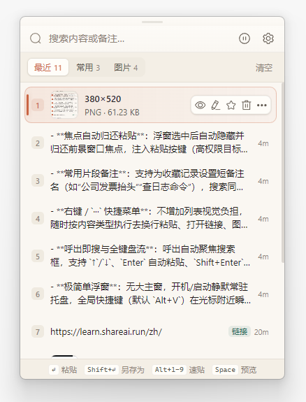
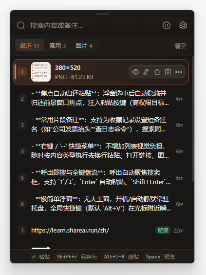

# MemoPaste

一款基于 Electron + Vue 3 的极简单浮窗剪贴板工具，常驻系统托盘，随时快捷键呼出、呼出即搜、自动粘贴。

## 界面预览

| 浅色主题 | 深色主题 |
| :------: | :------: |
|  |  |

## 特性

- **极简单浮窗**：无大主窗，开机/启动静默常驻托盘，全局快捷键（默认 `Alt+V`）在光标附近瞬时呼出
- **呼出即搜与全键盘流**：呼出自动聚焦搜索框，支持 `↑`/`↓`、`Enter` 自动粘贴、`Shift+Enter` 快捷轻加工（文本去换行粘贴 / 链接浏览器打开 / 图片另存为 PNG）、`Alt+1~9` 秒贴、`Tab` 切换分类、`Space` 预览全文、`F2` 编辑备注、`Shift+Delete` 删除、`Esc` 清空/隐藏
- **右键 / `···` 快捷菜单**：不增加列表视觉负担，随时按内容类型执行去换行粘贴、打开链接、图片另存为、仅复制等操作
- **常用片段备注**：支持为收藏记录设置短备注名（如“公司发票抬头”“查日志命令”），搜索同时匹配备注与正文
- **焦点自动归还粘贴**：浮窗选中后自动隐藏并归还前景窗口焦点，注入粘贴按键（高权限目标窗口自动降级为复制并提示）
- **隐私保护与暂停监听**：自动识别 Windows/macOS 剪贴板隐私标记与常见密码管理器进程跳过入库，并支持在浮窗顶栏或托盘菜单一键手动暂停/恢复记录
- **本地存储与图片支持**：数据保存在本地 SQLite，图片支持缩略图与原尺寸回贴，去重置顶并保留收藏与备注；非收藏历史 24 小时后自动清理
- **内嵌轻量设置**：支持快捷键录制、浅色/深色主题与开机自启

## 技术栈

| 类别 | 技术                                           |
| ---- | ---------------------------------------------- |
| 前端 | Vue 3、TypeScript、Pinia                       |
| 构建 | Vite、vite-plugin-electron                     |
| 桌面 | Electron、koffi（Windows 焦点恢复与模拟粘贴） |
| 存储 | SQLite（better-sqlite3）、electron-store       |

## 快速开始

### 源码运行

**环境要求**：Node.js 22.13+（测试依赖内置 SQLite）

```bash
# 安装依赖
npm install

# 如遇 better-sqlite3 原生模块问题，可执行
npm run sqlite3-rebuild

# 启动开发环境
npm run dev
```

### 构建安装包

```bash
npm run build
```

产物由 electron-builder 生成，输出目录见构建日志。

## 验证

- 单元测试：`npm test`
- 类型与规范检查：`npx vue-tsc --noEmit` 和 `npm run lint`
- 界面冒烟回归：先执行 `npx vite build`，再执行 `npm run test:ui`（使用独立临时配置和模拟数据，截图保存在终端输出的临时目录中）
- 外部应用自动粘贴仍需在真实桌面窗口（如记事本、VS Code、浏览器）中手工验证

## License

[MIT](./LICENSE)
